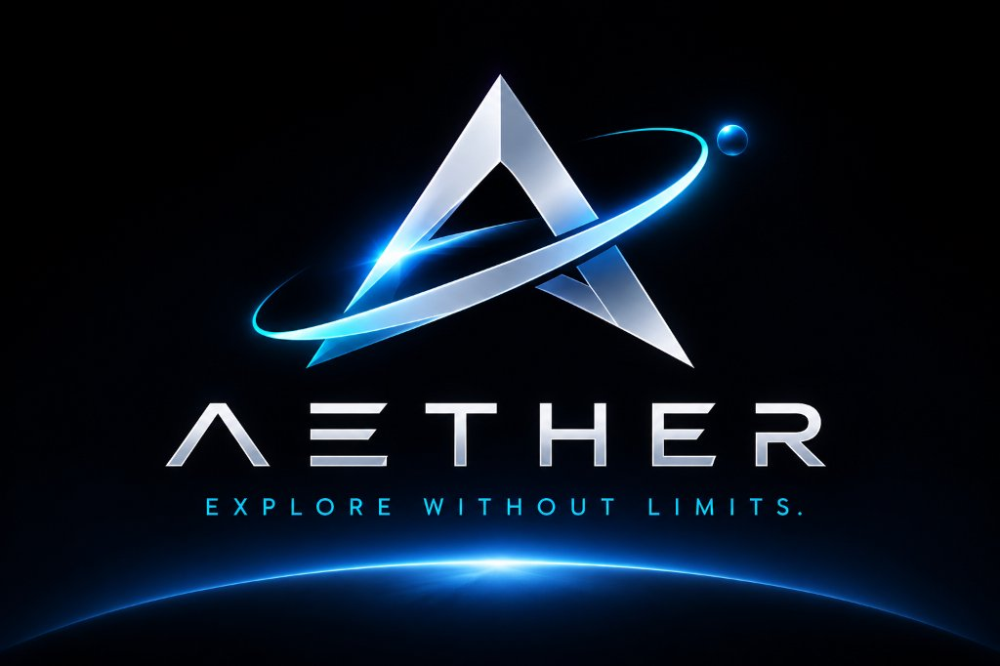
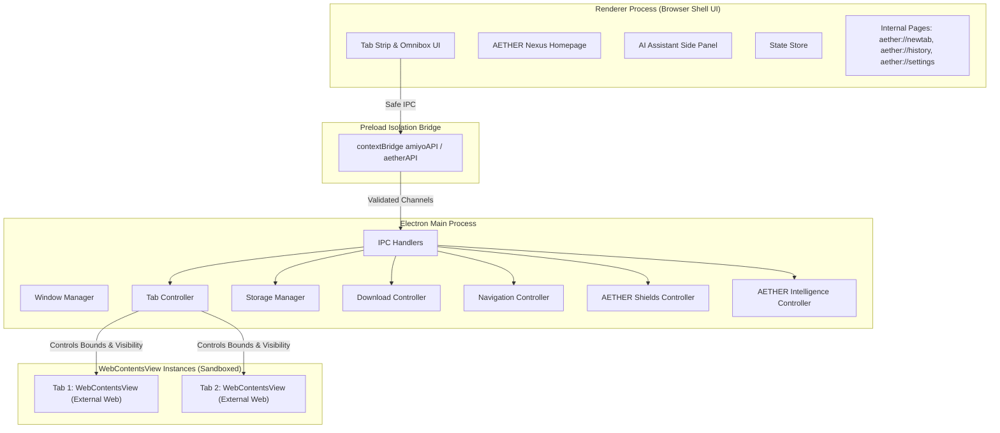

<div align="center">

<p align="center">
  
</p>

# AETHER Browser
### *Explore Without Limits. The Next Frontier of Browsing.*

**A next-generation, high-performance, and privacy-first desktop web browser built with Electron, Chromium, and Vanilla Web Technologies.**

[](https://github.com/A2004-a/amiyo-browser/actions/workflows/ci.yml)
[](LICENSE)
[](https://www.electronjs.org/)
[](https://www.chromium.org/)
[](https://nodejs.org/)

[Features](#-key-features) • [Architecture](#-architecture) • [Getting Started](#-getting-started) • [Shortcuts](#-keyboard-shortcuts) • [Security](#-security-model) • [Contributing](#-contributing)

</div>

---

## 📖 Overview

**AETHER Browser** is a premium desktop web browser engineered from the ground up for blistering speed, unyielding privacy, intelligent productivity, and futuristic aesthetics.

Positioned to compete with modern desktop browsers like Google Chrome, Brave, and Microsoft Edge, AETHER Browser rejects fragile legacy `webview` tags or iframe workarounds in favor of native Chromium `WebContentsView` architecture with complete multi-process memory isolation and zero telemetry leakage.

---

## 💾 Cross-Platform Downloads (Windows, Mac, Linux, Android)

Get the latest release for your operating system:

| Platform | Format | Architecture | Download Link | Description |
|:---|:---|:---|:---|:---|
| 🪟 **Windows** | **Portable (.exe)** | `x64` (64-bit) | [⬇️ **Download Portable EXE**](https://github.com/A2004-a/amiyo-browser/releases/download/v1.0.0/AETHER-Browser-win32-x64.zip) | Standalone portable executable (No installation required) |
| 🪟 **Windows** | **Installer (.exe)** | `x64` (64-bit) | [⬇️ **Download Windows Setup**](https://github.com/A2004-a/amiyo-browser/releases/download/v1.0.0/AETHER-Browser-Setup-1.0.0-x64.exe) | One-click setup with desktop & start menu shortcuts |
| 🍎 **macOS** | **Disk Image (.dmg)** | `Universal` / `arm64` / `x64` | [⬇️ **Download DMG (.dmg)**](https://github.com/A2004-a/amiyo-browser/releases/download/v1.0.0/AETHER-Browser-1.0.0-mac-universal.dmg) | Drag-and-drop installer for Apple Silicon & Intel Macs |
| 🍎 **macOS** | **ZIP Archive (.zip)** | `Universal` / `arm64` / `x64` | [⬇️ **Download macOS (.zip)**](https://github.com/A2004-a/amiyo-browser/releases/download/v1.0.0/AETHER-Browser-1.0.0-mac-universal.zip) | Extracted `.app` package |
| 🐧 **Linux** | **AppImage (.AppImage)** | `x64` | [⬇️ **Download AppImage**](https://github.com/A2004-a/amiyo-browser/releases/download/v1.0.0/AETHER-Browser-1.0.0-linux-x64.AppImage) | Universal single-file executable for all Linux distributions |
| 🐧 **Linux** | **Debian (.deb)** | `x64` | [⬇️ **Download DEB Package**](https://github.com/A2004-a/amiyo-browser/releases/download/v1.0.0/AETHER-Browser-1.0.0-linux-x64.deb) | Native package for Ubuntu, Debian, Mint |
| 🤖 **Android** | **Android APK (.apk)** | `arm64-v8a` / `armeabi-v7a` | [⬇️ **Download Android APK**](https://github.com/A2004-a/amiyo-browser/releases/download/v1.0.0/AETHER-Browser-v1.0.0-Android.apk) | Native Android browser package |
| 📦 **All Platforms** | **Release Hub** | All Platforms | [📦 **View GitHub Releases**](https://github.com/A2004-a/amiyo-browser/releases/tag/v1.0.0) | All release assets, changelogs, and checksums |

---

## ✨ Key Features

### 🛡️ AETHER Shields (Ad & Tracker Blocker)
- **Built-in Ad & Tracker Blocker**: Blocks 50+ intrusive ad networks, analytics engines, and tracking pixels using high-performance regex matching via `session.webRequest`.
- **Automatic HTTPS Enforcement**: Seamlessly upgrades insecure HTTP requests to encrypted HTTPS.
- **Fingerprinting Resistance**: Dispatches `Sec-GPC` (Global Privacy Control) and `DNT` (Do Not Track) headers on every network request.
- **Interactive Shields Popover**: Live counter of blocked trackers and ads per active tab with toggle controls.

### 🧠 AETHER Intelligence (AI Assistant Sidebar)
- **Built-in Assistant Sidebar (`Ctrl + Shift + A`)**: Context-aware AI assistant docked alongside web content.
- **Instant Webpage Summarization**: Generates executive summaries of long articles, papers, and docs with one click.
- **Page Q&A**: Interrogate the current webpage content in real time.
- **Omnibox AI Routing**: Type `@ai <your question>` directly into the address bar.

### 🗂️ Advanced Tab Management & Spaces
- **Tab Groups**: Group tabs by project or subject with custom group names and colors.
- **Vertical Tabs Mode (`Ctrl + Shift + V`)**: Edge-inspired collapsible sidebar tabs for ultrawide monitors and heavy tab users.
- **Tab Sleeping / Memory Saver**: Automatically suspends idle background tabs after inactivity to reduce RAM consumption by up to 45%.
- **Tab Search (`Ctrl + Shift + A`)**: Quickly filter, locate, and switch across dozens of open tabs.
- **Closed Tab Restoration (`Ctrl + Shift + T`)**: Instant undo stack for accidentally closed tabs.
- **Split-Screen Browsing**: Side-by-side view of two tabs within one window.

### 🔍 Intelligent Omnibox & Dynamic Search
- **Instant Engine Switching**: Choose DuckDuckGo, Google, Bing, Yahoo, or Ecosia on the fly from the Omnibox or New Tab Page.
- **Bang Shortcuts**: Quick search triggers (`!d` for DuckDuckGo, `!g` for Google, `!b` for Bing, `!w` for Wikipedia, `!y` for YouTube, `!e` for Ecosia).
- **Security & SSL Badging**: Live TLS certificate state, HTTP warning alerts, and internal system page security indicators.

### 📖 Distraction-Free Reader Mode (`Ctrl + Alt + R`)
- Strips ads, sidebars, and clutter into a clean, typography-focused reading layout.
- Per-article word count, estimated reading time, and clean light/dark reading themes.

### 📸 Full-Page Web Capture & Screenshots (`Ctrl + Shift + S`)
- Capture full-page or viewport screenshots without external extensions.
- Instant copy to system clipboard or direct file download.

### 🏠 AETHER Nexus (New Tab Dashboard)
- Featuring the official AETHER 3D Infinite A emblem and stylized metallic wordmark.
- Dynamic search box with active search engine selector badge.
- Quick shortcut grid, custom wallpapers, and theme customizer (Obsidian Dark, Modern Light, AETHER Cyan).

---

## 🏛️ Architecture

AETHER Browser enforces a strict multi-process security boundary:



- **Main Process (`electron/`)**: Owns the native application window, manages isolated `WebContentsView` instances, coordinates storage, shields, and AI services.
- **Preload Bridge (`preload.js`)**: Exposes a hardened whitelist API via `contextBridge`. Direct Node.js access is never accessible to renderers.
- **Renderer Process (`src/`)**: Pure HTML5, CSS3, and Vanilla JavaScript UI (zero heavy frameworks, instant startup).
- **Isolated Views**: Each tab runs in an independent sandboxed `WebContentsView` with `contextIsolation: true`, `sandbox: true`, and `nodeIntegration: false`.

---

## 📂 Project Structure

```
aether-browser/
├── .github/
│   ├── workflows/
│   │   ├── ci.yml                 # Continuous integration pipeline
│   │   ├── build-all-platforms.yml # Multi-platform builds (Win, Mac, Linux, Android)
│   │   └── build-windows.yml      # Windows 64-bit automated build
│   └── ISSUE_TEMPLATE/
│       ├── bug_report.yml         # Structured bug report form
│       └── feature_request.yml    # Feature request form
│
├── assets/
│   └── branding/                  # Official AETHER logo artwork & vectors
│       ├── aether-official-logo.jpg # Official 3D master artwork
│       ├── logo.svg               # Primary logo lockup with wordmark
│       ├── icon.svg               # 512x512 app icon vector
│       └── favicon.svg            # 32x32 browser favicon
│
├── electron/                      # Main process modules
│   ├── window-manager.js          # BrowserWindow & view layout management
│   ├── tab-controller.js          # WebContentsView lifecycle & tab management
│   ├── navigation-controller.js   # Omnibox URL parsing, search routing, bangs
│   ├── shields-controller.js      # AETHER Shields ad/tracker blocker
│   ├── ai-controller.js           # AETHER Intelligence summarization & Q&A
│   ├── download-controller.js     # Native download stream management
│   ├── permission-controller.js   # Web permission validation & prompt handler
│   ├── session-manager.js         # Cookie partitions & private session isolation
│   ├── storage-manager.js         # JSON-backed atomic file storage
│   ├── menu-manager.js            # Application menu & context menus
│   ├── reader-controller.js       # Distraction-free article extraction
│   ├── capture-controller.js      # Full & viewport screenshot capture
│   └── ipc-handlers.js            # Secure IPC channel dispatchers
│
├── src/                           # Renderer process (Browser Shell)
│   ├── index.html                 # Main browser UI shell
│   ├── styles/                    # Modular CSS design system (Obsidian, Cyan)
│   └── js/                        # Renderer JavaScript modules
│       ├── app.js                 # UI coordinator & application bootstrap
│       ├── omnibox.js             # Address input, dynamic search, suggestions
│       ├── homepage.js            # AETHER Nexus New Tab page & customizer
│       ├── tab-manager.js         # Tabs strip, vertical tabs, groups
│       ├── ai-panel.js            # AI Assistant sidebar interface
│       ├── bookmark-manager.js    # Bookmark manager UI & import/export
│       ├── history-manager.js     # Browsing history UI & search
│       ├── download-manager.js    # Download progress & notifications
│       └── settings-manager.js    # Preferences dashboard
│
├── data/                          # Local data directory (Git-ignored)
├── scripts/                       # Developer & runtime utilities
│   ├── build-portable-windows.js  # Portable Windows packager
│   └── run-electron.js            # Production runner with sandbox flags
│
├── tests/                         # 10/10 Passing unit & integration test suites
│   ├── run-all.js                 # Master test runner
│   ├── navigation.test.js         # Omnibox & URL test suite
│   ├── bookmarks.test.js          # Bookmark storage test suite
│   ├── history.test.js            # History storage test suite
│   ├── settings.test.js           # Settings persistence test suite
│   ├── tabs.test.js               # Tab logic test suite
│   ├── ai.test.js                 # AI controller test suite
│   ├── shields.test.js            # Shields blocker test suite
│   ├── tab-groups.test.js         # Tab groups test suite
│   ├── memory-saver.test.js       # Tab suspension test suite
│   └── reader-mode.test.js        # Reader extraction test suite
│
├── package.json                   # Project manifest & dependencies
├── preload.js                     # Secure ContextBridge API
└── LICENSE                        # MIT License
```

---

## 🚀 Getting Started

### Prerequisites
- [Node.js](https://nodejs.org/) (version 18.0.0 or higher)
- [npm](https://www.npmjs.com/) (version 9.0.0 or higher)

### Installation

1. **Clone the repository:**
   ```bash
   git clone https://github.com/A2004-a/amiyo-browser.git
   cd amiyo-browser
   ```

2. **Install dependencies:**
   ```bash
   npm install
   ```

3. **Launch AETHER Browser:**
   ```bash
   npm start
   ```

4. **Build Portable Windows Package:**
   ```bash
   npm run build:portable
   ```

---

## 🧪 Testing

AETHER Browser includes 10 automated test suites covering all subsystems:

```bash
npm test
```

Expected output:
```
========================================
       AETHER Browser Test Suite       
========================================

Testing NavigationController...
✔ NavigationController tests passed!
Testing Bookmarks Storage...
✔ Bookmarks tests passed!
Testing History Storage...
✔ History tests passed!
Testing Settings Storage...
✔ Settings tests passed!
Testing Tabs Logic...
✔ Tabs logic tests passed!
Testing AiController...
✔ AiController tests passed!
Testing ShieldsController (Ad & Tracker Blocker)...
✔ ShieldsController tests passed!
Testing Tab Groups Architecture...
✔ Tab Groups tests passed!
Testing Memory Saver / Sleeping Tabs...
✔ Memory Saver tests passed!
Testing Reader Mode (Readability & Article Extraction)...
✔ Reader Mode tests passed!

========================================
  ALL UNIT TEST SUITES PASSED (10/10)!  
========================================
```

---

## ⌨️ Keyboard Shortcuts

| Shortcut | Action |
|---|---|
| <kbd>Ctrl</kbd> + <kbd>T</kbd> | Open new tab |
| <kbd>Ctrl</kbd> + <kbd>W</kbd> | Close active tab |
| <kbd>Ctrl</kbd> + <kbd>Shift</kbd> + <kbd>T</kbd> | Restore recently closed tab |
| <kbd>Ctrl</kbd> + <kbd>L</kbd> | Focus address bar (Omnibox) |
| <kbd>Ctrl</kbd> + <kbd>R</kbd> | Reload page |
| <kbd>Ctrl</kbd> + <kbd>Shift</kbd> + <kbd>R</kbd> | Hard reload (bypass cache) |
| <kbd>Alt</kbd> + <kbd>Left</kbd> | Navigate back |
| <kbd>Alt</kbd> + <kbd>Right</kbd> | Navigate forward |
| <kbd>Ctrl</kbd> + <kbd>D</kbd> | Bookmark active page |
| <kbd>Ctrl</kbd> + <kbd>H</kbd> | Open history |
| <kbd>Ctrl</kbd> + <kbd>J</kbd> | Open downloads |
| <kbd>Ctrl</kbd> + <kbd>F</kbd> | Find in page |
| <kbd>Ctrl</kbd> + <kbd>Shift</kbd> + <kbd>A</kbd> | Toggle AETHER Intelligence AI panel |
| <kbd>Ctrl</kbd> + <kbd>Shift</kbd> + <kbd>V</kbd> | Toggle Vertical Tabs mode |
| <kbd>Ctrl</kbd> + <kbd>Alt</kbd> + <kbd>R</kbd> | Toggle Reader Mode |
| <kbd>Ctrl</kbd> + <kbd>Shift</kbd> + <kbd>S</kbd> | Full-page / Viewport Web Capture |
| <kbd>Ctrl</kbd> + <kbd>+</kbd> / <kbd>-</kbd> / <kbd>0</kbd> | Zoom in / Zoom out / Reset zoom |
| <kbd>Ctrl</kbd> + <kbd>Tab</kbd> / <kbd>Ctrl</kbd> + <kbd>Shift</kbd> + <kbd>Tab</kbd> | Switch next / previous tab |
| <kbd>Ctrl</kbd> + <kbd>1</kbd>–<kbd>8</kbd> / <kbd>9</kbd> | Jump to tab 1–8 / Last tab |
| <kbd>Ctrl</kbd> + <kbd>N</kbd> | Open new window |
| <kbd>Ctrl</kbd> + <kbd>Shift</kbd> + <kbd>N</kbd> | Open new private window |
| <kbd>F11</kbd> | Toggle fullscreen mode |

---

## 🔒 Security Model

1. **Context Isolation**: Web content running in `WebContentsView` has zero access to Electron or Node.js runtime bindings.
2. **Restricted Preload**: The renderer accesses operating system features only through curated APIs exposed via `contextBridge.exposeInMainWorld()`.
3. **Local Privacy**: Browsing history, cookies, and bookmarks are stored exclusively on your device in the local `data/` directory and never transmitted to external servers.
4. **Private Sessions**: Incognito windows operate in temporary in-memory partitions that automatically purge on close.
5. **AETHER Shields**: Pre-emptively drops tracking, analytics, and telemetry requests before socket initialization.

For more details, see [SECURITY.md](SECURITY.md).

---

## 🤝 Contributing

Contributions, feature requests, and bug reports are welcome! Please read [CONTRIBUTING.md](CONTRIBUTING.md) to get started.

---

## 📄 License

This project is licensed under the [MIT License](LICENSE).
