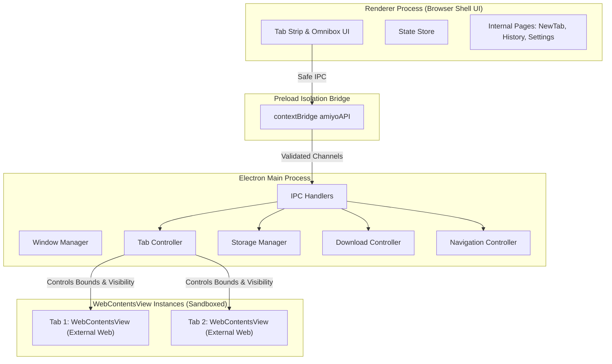

<div align="center">

# 🌐 AMIYO Browser

**A modern, fast, and secure desktop web browser built with Electron, Chromium, and Vanilla Web Technologies.**

[](https://github.com/A2004-a/amiyo-browser/actions/workflows/ci.yml)
[](LICENSE)
[](https://www.electronjs.org/)
[](https://nodejs.org/)
[](https://www.chromium.org/)

[Features](#-key-features) • [Architecture](#-architecture) • [Getting Started](#-getting-started) • [Shortcuts](#-keyboard-shortcuts) • [Security](#-security-model) • [Contributing](#-contributing)

</div>

---

## 📖 Overview

**AMIYO Browser** is a desktop web browser engineered from the ground up for speed, privacy, and productivity. Combining an original minimalist UI with a multi-process architecture, AMIYO Browser renders web content using native Chromium `WebContentsView` instances with zero legacy `<webview>` tags or iframe hacks.

---

## 💾 Download for Windows (64-bit)

Get the latest release for **Windows 10 / 11 (64-bit)**:

| Format | Architecture | Download Link | Description |
|:---|:---|:---|:---|
| **Windows Installer (.exe)** | `x64` (64-bit) | [⬇️ **Download Installer (.exe)**](https://github.com/A2004-a/amiyo-browser/releases/download/v1.0.0/AMIYO-Browser-Setup-1.0.0-x64.exe) | Interactive setup with desktop & start menu shortcuts |
| **Portable ZIP Archive** | `x64` (64-bit) | [⬇️ **Download ZIP (.zip)**](https://github.com/A2004-a/amiyo-browser/releases/download/v1.0.0/AMIYO-Browser-Setup-1.0.0-x64.zip) | Extracted directory package (run without installation) |
| **All Releases & Assets** | `x64` (64-bit) | [📦 **View GitHub Releases**](https://github.com/A2004-a/amiyo-browser/releases) | Official releases, changelogs, and release binaries |
| **CI Build Artifacts (Mirror)** | `x64` (64-bit) | [⬇️ **Download from GitHub Actions**](https://github.com/A2004-a/amiyo-browser/actions/runs/43255073885) | Compiled artifact backup from CI pipeline |

> 🚀 **Automated Builds**: Compiled and signed through our continuous integration pipeline: [Build Windows 64-bit Workflow](https://github.com/A2004-a/amiyo-browser/actions/workflows/build-windows.yml).

---

## ✨ Key Features

### 🗂️ Advanced Tab Management
- Multi-tab lifecycle: create, switch, duplicate, close, and pin tabs.
- Drag-and-drop tab reordering with smooth animations.
- Live favicon resolution and page title synchronization.
- Tab audio status indicator and mute/unmute control.
- Closed tab restoration stack (`Ctrl + Shift + T`).
- Session preservation across browser restarts.

### 🔍 Intelligent Omnibox & Navigation
- Real-time search query resolution with automatic HTTPS upgrades.
- Real-time search suggestions with multi-provider support (Google, Bing, DuckDuckGo, custom).
- Integrated history and bookmark suggestions.
- Live connection security indicator (Secure HTTPS vs Insecure vs System).
- Dynamic navigation controls: Back, Forward, Reload, Hard Reload, Stop, and Home.
- Animated loading progress tracker.

### 🏠 Customizable New Tab Dashboard
- Live clock and personalized greeting.
- Quick-access favorites grid with custom URL additions.
- Shortcuts to Bookmarks, History, Downloads, and Settings.
- Clean Dark Charcoal and Crisp Light theme styling.

### 📚 Bookmarks & History
- Interactive bookmark bar below navigation toolbar.
- Full bookmark manager (`amiyo://bookmarks`) with folder hierarchy and JSON import/export.
- Chronologically grouped browsing history with instantaneous search and range deletion.

### ⬇️ Download Manager
- Real-time progress bar, transfer speed, and remaining size calculations.
- Pause, resume, and cancel active downloads.
- Direct file launch or reveal in system file explorer.

### 🛡️ Private Browsing Mode
- Isolated in-memory partition (`Ctrl + Shift + N`).
- No browsing history, cookies, or cache retained on window close.
- Distinct visual identity and privacy badge.

### ⚙️ Deep Customization & Productivity
- Find in Page (`Ctrl + F`) with match highlighting and counter.
- Per-tab zoom controls (25% to 500%).
- Context menus tailored for links, media, selections, and editing.
- Comprehensive Settings dashboard (`amiyo://settings`).

---

## 🏛️ Architecture

AMIYO Browser enforces a strict multi-process boundary:



- **Main Process (`electron/`)**: Owns the native application window, manages `WebContentsView` instances, coordinates storage, and supervises downloads.
- **Preload Bridge (`preload.js`)**: Exposes a whitelisted API through `contextBridge.exposeInMainWorld('amiyoAPI', ...)`. Direct Node.js access is never accessible to the renderer.
- **Renderer Process (`src/`)**: Pure HTML5, CSS3, and Vanilla JavaScript UI.
- **Isolated Views**: Each tab runs in an independent `WebContentsView` with `contextIsolation: true`, `sandbox: true`, and `nodeIntegration: false`.

---

## 📂 Project Structure

```
amiyo-browser/
├── .github/
│   ├── workflows/
│   │   └── ci.yml                 # Continuous integration pipeline
│   ├── ISSUE_TEMPLATE/
│   │   ├── bug_report.yml         # Structured bug report form
│   │   ├── feature_request.yml    # Feature request form
│   │   └── config.yml             # Issue configuration
│   ├── pull_request_template.md   # Standard pull request checklist
│   └── dependabot.yml             # Automated dependency updates
│
├── electron/                      # Main process modules
│   ├── window-manager.js          # BrowserWindow & view layout management
│   ├── tab-controller.js          # WebContentsView lifecycle & tab management
│   ├── navigation-controller.js   # Omnibox URL parsing & search routing
│   ├── download-controller.js     # Native download stream management
│   ├── permission-controller.js   # Web permission validation & prompt handler
│   ├── session-manager.js         # Cookie partitions & private session isolation
│   ├── storage-manager.js         # JSON-backed atomic file storage
│   ├── menu-manager.js            # Application menu & context menus
│   └── ipc-handlers.js            # Secure IPC channel dispatchers
│
├── src/                           # Renderer process (Browser Shell)
│   ├── index.html                 # Main browser UI shell
│   ├── styles/                    # Modular CSS design system
│   │   ├── variables.css          # Design tokens & color palettes
│   │   ├── global.css             # Base resets & typography
│   │   ├── browser.css            # Shell framing & view container
│   │   ├── toolbar.css            # Navigation controls & omnibox
│   │   ├── tabs.css               # Tabs strip & tab item states
│   │   ├── homepage.css           # New Tab dashboard
│   │   ├── bookmarks.css          # Bookmarks toolbar & manager
│   │   ├── history.css            # History view & date grouping
│   │   ├── downloads.css          # Downloads progress bar & list
│   │   └── settings.css           # Preferences dashboard
│   ├── js/                        # Renderer JavaScript modules
│   │   ├── app.js                 # UI coordinator & application bootstrap
│   │   ├── state.js               # Reactive client state container
│   │   ├── ipc-client.js          # Client bridge to preload amiyoAPI
│   │   ├── tab-manager.js         # Tab events & DOM synchronization
│   │   ├── navigation.js          # Back/forward/reload buttons
│   │   ├── omnibox.js             # Address input, suggestions, & SSL state
│   │   ├── homepage.js            # Dashboard rendering & widgets
│   │   ├── bookmark-manager.js    # Bookmark manager UI & import/export
│   │   ├── history-manager.js     # Browsing history UI & search
│   │   ├── download-manager.js    # Download progress & notifications
│   │   ├── settings-manager.js    # Settings configuration panels
│   │   ├── theme-manager.js       # Dark / Light / System theme engine
│   │   ├── keyboard-shortcuts.js  # Global accelerator bindings
│   │   └── utils.js               # Helper utilities & SVG icons
│   └── assets/
│       └── icons/
│           └── logo.svg           # Branded AMIYO Browser SVG monogram
│
├── data/                          # Local data directory
│   └── .gitkeep                   # Tracks directory while ignoring user data
│
├── scripts/                       # Developer & runtime utilities
│   ├── run-electron.js            # Production runner with sandbox flags
│   ├── test-server.js             # Local HTTP test server
│   ├── test-render.js             # Automated renderer verification
│   └── test-navigation-interaction.js # Navigation integration script
│
├── tests/                         # Test suites
│   ├── run-all.js                 # Unit test runner
│   ├── navigation.test.js         # Omnibox & URL test suite
│   ├── bookmarks.test.js          # Bookmark storage test suite
│   ├── history.test.js            # History storage test suite
│   ├── settings.test.js           # Settings persistence test suite
│   ├── tabs.test.js               # Tab logic test suite
│   └── e2e-verification.js        # Comprehensive Electron E2E suite
│
├── .editorconfig                  # Consistent cross-editor formatting
├── .gitattributes                 # Line-ending normalization rules
├── .gitignore                     # Repository exclusions
├── CHANGELOG.md                   # Version release notes
├── CONTRIBUTING.md                # Developer contribution guidelines
├── LICENSE                        # MIT License
├── package.json                   # Project manifest & dependencies
├── preload.js                     # Secure ContextBridge API
└── SECURITY.md                    # Vulnerability reporting & policy
```

---

## 🚀 Getting Started

### Prerequisites
- [Node.js](https://nodejs.org/) (version 18.0.0 or higher)
- [npm](https://www.npmjs.com/) (version 9.0.0 or higher)

### Installation

1. **Clone the repository:**
   ```bash
   git clone https://github.com/A2004-a/amiyo-browser.git
   cd amiyo-browser
   ```

2. **Install dependencies:**
   ```bash
   npm install
   ```

3. **Launch the browser:**
   ```bash
   npm start
   ```

---

## 🧪 Testing

AMIYO Browser includes unit and end-to-end test suites.

- **Run unit tests:**
  ```bash
  npm test
  ```

- **Run comprehensive end-to-end tests:**
  ```bash
  npm run test:e2e
  ```

---

## ⌨️ Keyboard Shortcuts

| Shortcut | Description |
|---|---|
| <kbd>Ctrl</kbd> + <kbd>T</kbd> | Open new tab |
| <kbd>Ctrl</kbd> + <kbd>W</kbd> | Close active tab |
| <kbd>Ctrl</kbd> + <kbd>Shift</kbd> + <kbd>T</kbd> | Reopen recently closed tab |
| <kbd>Ctrl</kbd> + <kbd>L</kbd> | Focus address bar / Omnibox |
| <kbd>Ctrl</kbd> + <kbd>R</kbd> | Reload page |
| <kbd>Ctrl</kbd> + <kbd>Shift</kbd> + <kbd>R</kbd> | Hard reload (bypass cache) |
| <kbd>Alt</kbd> + <kbd>Left</kbd> | Navigate back |
| <kbd>Alt</kbd> + <kbd>Right</kbd> | Navigate forward |
| <kbd>Ctrl</kbd> + <kbd>D</kbd> | Bookmark active page |
| <kbd>Ctrl</kbd> + <kbd>H</kbd> | Open browsing history |
| <kbd>Ctrl</kbd> + <kbd>J</kbd> | Open downloads manager |
| <kbd>Ctrl</kbd> + <kbd>F</kbd> | Find in page |
| <kbd>Ctrl</kbd> + <kbd>+</kbd> / <kbd>=</kbd> | Zoom in |
| <kbd>Ctrl</kbd> + <kbd>-</kbd> | Zoom out |
| <kbd>Ctrl</kbd> + <kbd>0</kbd> | Reset zoom to 100% |
| <kbd>Ctrl</kbd> + <kbd>Tab</kbd> | Switch to next tab |
| <kbd>Ctrl</kbd> + <kbd>Shift</kbd> + <kbd>Tab</kbd> | Switch to previous tab |
| <kbd>Ctrl</kbd> + <kbd>1</kbd>–<kbd>8</kbd> | Jump to tab 1 through 8 |
| <kbd>Ctrl</kbd> + <kbd>9</kbd> | Jump to last tab |
| <kbd>Ctrl</kbd> + <kbd>N</kbd> | Open new browser window |
| <kbd>Ctrl</kbd> + <kbd>Shift</kbd> + <kbd>N</kbd> | Open new private window |
| <kbd>F11</kbd> | Toggle fullscreen |

---

## 🔒 Security Model

1. **Context Isolation**: Web content running in `WebContentsView` has no access to Electron or Node.js runtime bindings.
2. **Restricted Preload**: The renderer accesses operating system features only through curated APIs exposed via `contextBridge.exposeInMainWorld()`.
3. **Local Privacy**: Browsing history, cookies, and bookmarks are stored exclusively on your device in the local `data/` directory and never transmitted to external servers.
4. **Private Sessions**: Incognito windows operate in temporary in-memory partitions that automatically purge on close.

For more details, see [SECURITY.md](SECURITY.md).

---

## 🤝 Contributing

Contributions, feature requests, and bug reports are welcome! Please read [CONTRIBUTING.md](CONTRIBUTING.md) to get started.

---

## 📄 License

This project is licensed under the [MIT License](LICENSE).
